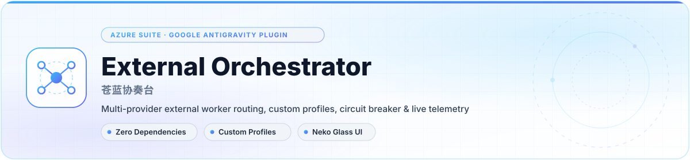
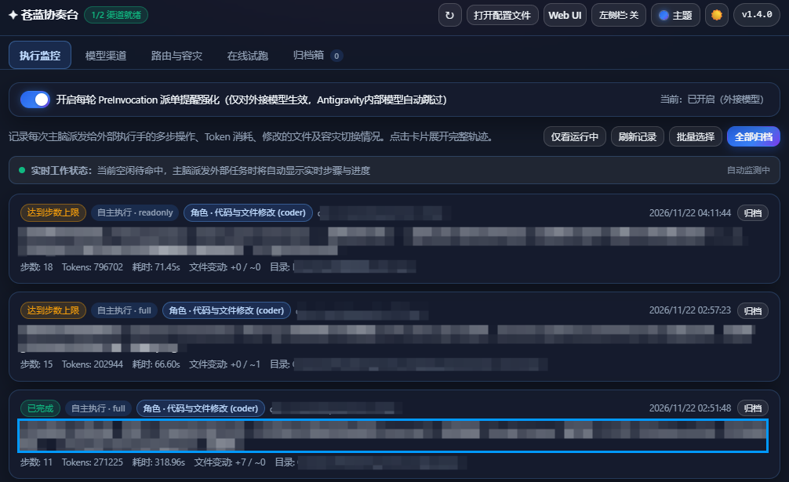
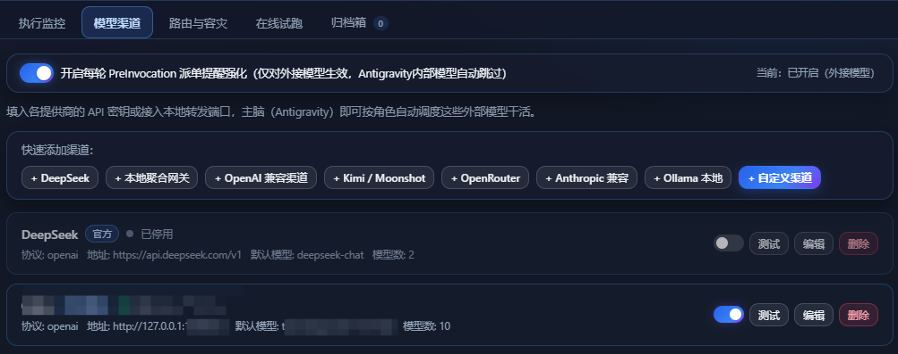
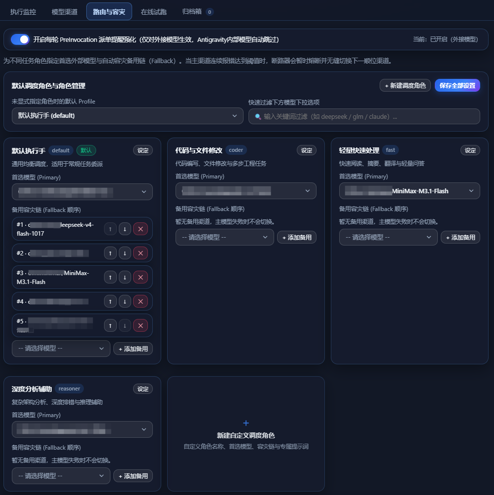
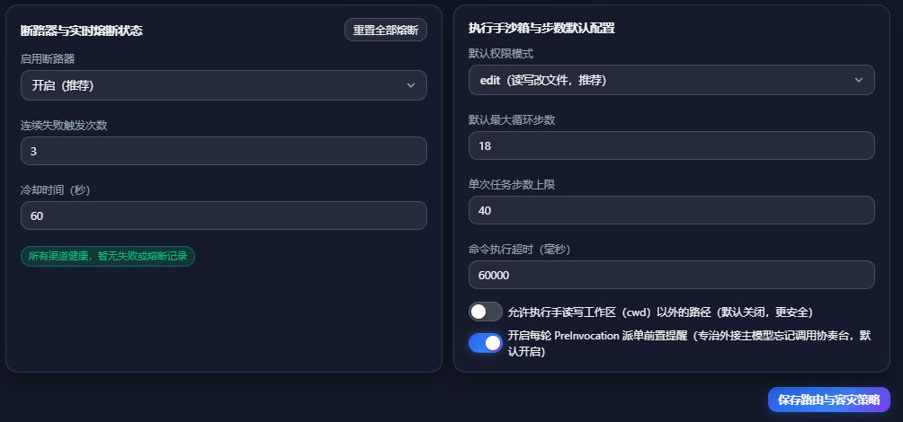
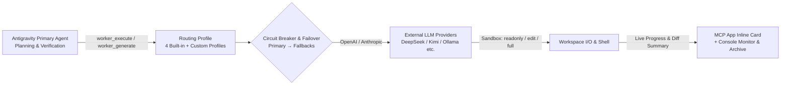

<div align="center">

<p>🌐 &nbsp; <a href="README.md">简体中文</a> &nbsp;·&nbsp; <strong>English</strong></p>

<picture>
  <source media="(prefers-color-scheme: dark)" srcset="assets/readme/hero-en-dark.svg">
  
</picture>

<p>
  <a href="https://github.com/A16Nights/antigravity-external-orchestrator/releases"></a>
  <a href="https://github.com/A16Nights/antigravity-external-orchestrator/stargazers"></a>
  
  
  
  <a href="./LICENSE"></a>
</p>

<p>
  <strong>Let Antigravity handle lightweight planning & final verification while delegating token-heavy reading, coding, shell commands, and generation to cost-effective external LLMs</strong>
</p>

<p>
  <a href="#preview">🖼️ Preview</a> &nbsp;·&nbsp; <a href="#features">✨ Features</a> &nbsp;·&nbsp; <a href="#architecture">🧩 Architecture</a> &nbsp;·&nbsp; <a href="#installation">🚀 Quick Start</a> &nbsp;·&nbsp; <a href="#mcp-tools">🧰 MCP Tools</a> &nbsp;·&nbsp; <a href="#storage">📂 Storage</a> &nbsp;·&nbsp; <a href="#azure-suite">🌌 Azure Suite</a>
</p>

</div>

A zero-dependency multi-provider external model orchestrator for **Google Antigravity**. Built strictly on official Antigravity extension primitives (**MCP Server + Sidecar Web UI + MCP App inline progress cards + Skill + Rule + Lifecycle Hook**) without touching `app.asar`.

<table>
<tr>
<td width="50%" valign="top">
<h4>🧠 Proactive Token-Saving Delegation</h4>
Ships with built-in <code>rules/AGENTS.md</code> delegation guidelines and an <code>external-model-guard</code> hook that routes multi-file reads, >15-line edits, log diagnostics, and bulk drafting to external workers.
</td>
<td width="50%" valign="top">
<h4>🎭 Unlimited Custom Routing Profiles</h4>
4 built-in profiles plus unlimited custom profiles (create, edit, delete), each with its own display label, default permission mode, primary model, fallback chain, and System Prompt.
</td>
</tr>
<tr>
<td width="50%" valign="top">
<h4>⚡ Circuit Breaker & Dual-Protocol</h4>
Native OpenAI-compatible (including DeepSeek <code>reasoning_content</code> pass-through) and Anthropic <code>/v1/messages</code> support with automatic cooldown circuit breaking and failover.
</td>
<td width="50%" valign="top">
<h4>📊 Live Telemetry & Safe Archive</h4>
Real-time inline MCP App progress cards, execution monitor, full tool-call trace playback, persistent profile badges, and a dedicated Archive Box.
</td>
</tr>
</table>

<h2 id="preview">
<picture>
  <source media="(prefers-color-scheme: dark)" srcset="assets/readme/sec-preview-en-dark.svg">
  
</picture>
</h2>

<table>
<tr>
<td width="50%" align="center" valign="top">
  <a href="assets/readme/preview-monitor.png"></a>
  <br><strong>Live Execution Monitor &amp; Profile Badges</strong>
  <br><sub>Real-time status bar, external-model reminder switch, profile badges, step/token stats &amp; archiving</sub>
</td>
<td width="50%" align="center" valign="top">
  <a href="assets/readme/preview-providers.png"></a>
  <br><strong>Multi-Provider Management</strong>
  <br><sub>7 quick-add provider presets with per-provider toggle, connectivity tests &amp; model editing</sub>
</td>
</tr>
<tr>
<td width="50%" align="center" valign="top">
  <a href="assets/readme/preview-routing.png"></a>
  <br><strong>Routing Profiles &amp; Fallback Chains</strong>
  <br><sub>4 built-in profiles + unlimited custom profiles with independent primary models &amp; ordered fallbacks</sub>
</td>
<td width="50%" align="center" valign="top">
  <a href="assets/readme/preview-breaker-sandbox.png"></a>
  <br><strong>Circuit Breaker &amp; Sandbox Policies</strong>
  <br><sub>Live provider health, failure threshold &amp; cooldown, plus default permission mode, step caps &amp; cwd guard</sub>
</td>
</tr>
</table>

<h2 id="features">
<picture>
  <source media="(prefers-color-scheme: dark)" srcset="assets/readme/sec-features-en-dark.svg">
  
</picture>
</h2>

### 1. Proactive Delegation & Smart External-Model Guard
- **Out-of-the-box Token-Saving Rules (`rules/AGENTS.md`)**:
  - Multi-file reads / codebase research / directory search → delegate to `worker_execute(mode: "readonly")` for concise summaries;
  - >15-line coding / multi-edit refactoring / scripts / tests → delegate to `worker_execute(mode: "edit" | "full")`;
  - Shell builds / test runs / verbose log analysis → delegate to `worker_execute(mode: "full")`;
  - Long-form drafting / summarization / translation / batch formatting → delegate to `worker_generate`.
- **Smart PreInvocation Reminder (`hooks/pre-invocation.mjs`)**:
  - Automatically detects whether the active primary model is an external custom model: injects per-turn delegation reminders only for external models (with per-turn deduplication) and stays silent on native Antigravity models. Toggleable in the header bar.
- **Silent Fallback**: If no external provider is configured or enabled, the primary agent seamlessly executes tasks itself with zero errors or workflow disruption.

### 2. Multi-Step Autonomous Worker (`worker_execute`) & Single-Turn Generation (`worker_generate`)
- **Three-Tier Sandbox Permissions**:
  - `readonly`: Read-only file inspection and search (`read_file`, `list_dir`, `search_files`);
  - `edit`: Create, modify, and patch files inside the workspace (blocks out-of-workspace writes unless explicitly enabled);
  - `full`: Additionally permits controlled terminal commands inside the workspace with timeout limits and dangerous-command guards.
- **Deep Dual-Protocol Compatibility**: Supports both OpenAI-compatible APIs (including multi-turn `reasoning_content` pass-through for DeepSeek R1 / Reasoner) and Anthropic `/v1/messages`.

### 3. Custom Routing Profiles + Fallback Chains + Circuit Breaker
- **4 Built-in Profiles + Unlimited Custom Profiles**:
  - Built-in `default`, `coder`, `fast`, and `reasoner` profiles;
  - **Create, edit, and delete custom profiles** (e.g., `reviewer`, `translator`, `architect`): configure Profile ID, Display Name, Description, Default Mode (`readonly` / `edit` / `full`), Primary Model, Ordered Fallback Chain, and Profile-Specific System Prompt;
  - Built-in profiles can also be customized (label, default mode, system prompt) while remaining protected against accidental deletion.
- **Automatic Circuit Breaker & Failover**:
  - Consecutive failures (default threshold: 3) or 429/5xx errors trip the circuit breaker into cooldown and seamlessly fail over down the profile's fallback chain; one-click reset available in the console.

### 4. Live Execution Monitor, Profile Badges & Archive Box
- **Live Status & MCP App Inline Progress Cards**:
  - Synchronizes live step progress bars, active tool actions, elapsed duration, and created/modified file counters across both the chat inline card and the console Monitor tab.
- **End-to-End Profile Badges**:
  - Displays clear **`Profile · Display Name (id)`** badges across active run cards, run history, archive cards, expanded details, and inline progress cards, snapshotting the profile name at run creation time.
- **Full Trace Playback & Dedicated Archive Box**:
  - Expand any run to inspect the full prompt, created/modified files, step-by-step tool calls, reasoning trace, and Markdown summary; supports single/batch archive, restore, and permanent cleanup.

### 5. Visual Multi-Provider Console & Playground
- **7 Quick-Add Provider Presets**: DeepSeek, Local Aggregator Gateway, OpenAI-Compatible, Kimi / Moonshot, OpenRouter, Anthropic-Compatible, and Local Ollama; one-click `/v1/models` fetch, multi-keyword filtering, and latency testing.
- **Interactive Playground**: Test either a routing profile (with live fallback) or a specific `provider:model` pair, inspecting reasoning output, response text, token usage, and failover attempts.

### 6. Unified Azure Suite UI
- **Neko Glass UI & Azure Theme Center**: Light/dark themes, glass dropdowns & modals, 6 official color presets + dual custom pickers + 4 cross-plugin custom slots, sidebar visibility toggle, standalone fullscreen `Web UI`, and GitHub Release update checks.

<h2 id="architecture">
<picture>
  <source media="(prefers-color-scheme: dark)" srcset="assets/readme/sec-arch-en-dark.svg">
  
</picture>
</h2>



<h2 id="installation">
<picture>
  <source media="(prefers-color-scheme: dark)" srcset="assets/readme/sec-install-en-dark.svg">
  
</picture>
</h2>

> **Prerequisite**: **Node.js >= 20.0.0** (zero third-party npm dependencies, pure native ESM).

### Option 1 · Let Antigravity Install It for You (Recommended)

Copy and send the following prompt directly to Antigravity:

> Please clone `https://github.com/A16Nights/antigravity-external-orchestrator.git` into my Antigravity global plugins directory as `external-orchestrator`, verify the directory structure, and tell me once it is ready so I can press `Ctrl+R` to reload.

### Option 2 · Manual Git Clone

```powershell
# Windows (PowerShell)
git clone https://github.com/A16Nights/antigravity-external-orchestrator.git "$env:USERPROFILE\.gemini\config\plugins\external-orchestrator"

# macOS / Linux
git clone https://github.com/A16Nights/antigravity-external-orchestrator.git ~/.gemini/config/plugins/external-orchestrator
```

Restart or reload Antigravity (`Ctrl+R`). The MCP tools, right-hand **External Orchestrator** sidecar panel, and delegation rules will activate automatically.

> 💡 You can also launch the standalone Web Console outside Antigravity: `node sidecars/console/server.mjs`.

<h2 id="mcp-tools">
<picture>
  <source media="(prefers-color-scheme: dark)" srcset="assets/readme/sec-tools-en-dark.svg">
  
</picture>
</h2>

| Tool | Description |
| --- | --- |
| `worker_list_models` | List configured external providers (keys masked), available models, all built-in/custom routing profiles, and live circuit-breaker states |
| `worker_execute` | Delegate multi-step file read/edit/search or shell command tasks to a routing `profile` with live inline progress cards and change summaries |
| `worker_generate` | Run fast single-turn text/code generation, summarization, translation, or analysis via a profile or model without touching local files |
| `worker_test_provider` | Test connectivity, protocol compatibility, and response latency for a configured provider |
| `worker_history` | List recent worker executions (including profile labels, duration, tokens) or inspect full step-by-step tool traces by `runId` |

<h2 id="storage">
<picture>
  <source media="(prefers-color-scheme: dark)" srcset="assets/readme/sec-storage-en-dark.svg">
  
</picture>
</h2>

<details open>
<summary><strong>Click to inspect local data paths & shared Azure Suite configs</strong></summary>

<br>

- **Providers, API Keys & Routing Profiles**: `~/.gemini/external-orchestrator/config.json`
- **Circuit Breaker & Active Progress**: `~/.gemini/external-orchestrator/breaker-state.json`, `active-runs.json`
- **Run History & Full Traces**: `~/.gemini/external-orchestrator/runs/`
- **Shared Azure Suite Theme & Sidebar Config**: `~/.gemini/azure-theme.json`, `~/.gemini/azure-sidebar-nav.json`

</details>

<h2 id="azure-suite">
<picture>
  <source media="(prefers-color-scheme: dark)" srcset="assets/readme/sec-suite-en-dark.svg">
  
</picture>
</h2>

All **8 Azure Suite plugins** share a unified **Neko Glass UI**, synchronized **Azure Theme Center** (`~/.gemini/azure-theme.json`), and customizable **Sidebar Navigation Hub** (`~/.gemini/azure-sidebar-nav.json`):

| Plugin | Repository | Core Capability |
| --- | --- | --- |
| ✦ **External Orchestrator** &nbsp;`✦ This Repo` | [antigravity-external-orchestrator](https://github.com/A16Nights/antigravity-external-orchestrator) | Multi-provider external worker routing, custom profiles, circuit breaker & live monitoring |
| 🪐 **Azure Orbit** | [antigravity-azure-orbit](https://github.com/A16Nights/antigravity-azure-orbit) | Mount external LLM APIs directly into Antigravity's native bottom-left model selector |
| 🧭 **Azure Compass** | [antigravity-azure-compass](https://github.com/A16Nights/antigravity-azure-compass) | Agent mode presets, live context telemetry with auto /compact & Azure Suite sidebar hub |
| 🏛️ **Azure Corridor** | [antigravity-azure-corridor](https://github.com/A16Nights/antigravity-azure-corridor) | Read-only FTS5 conversation search, custom project groups, priority tags & safe archive |
| 🌌 **Lanxi Memory** | [antigravity-lanxi-memory](https://github.com/A16Nights/antigravity-lanxi-memory) | 5-layer Markdown cognitive graph, CJK FTS5, tidal forgetting curves & starfield UI |
| 💎 **Soul.md Studio** | [antigravity-soul-md](https://github.com/A16Nights/antigravity-soul-md) | Hot-swappable persona cards, workspace binding, external-model anchor & layered memory |
| 💭 **Think-ZH** | [antigravity-think-zh](https://github.com/A16Nights/antigravity-think-zh) | Simplified Chinese / English reasoning switcher with dual-channel anti-drift hooks |
| 🔮 **Azure Prism** | [antigravity-azure-prism](https://github.com/A16Nights/antigravity-azure-prism) | Native MCP App Chain-of-Thought viewer with keyless zero-token MT & LLM translation |

---

<div align="center">

📄 Released under the <a href="./LICENSE"><strong>MIT License</strong></a> · Crafted for <strong>Google Antigravity</strong>

</div>
